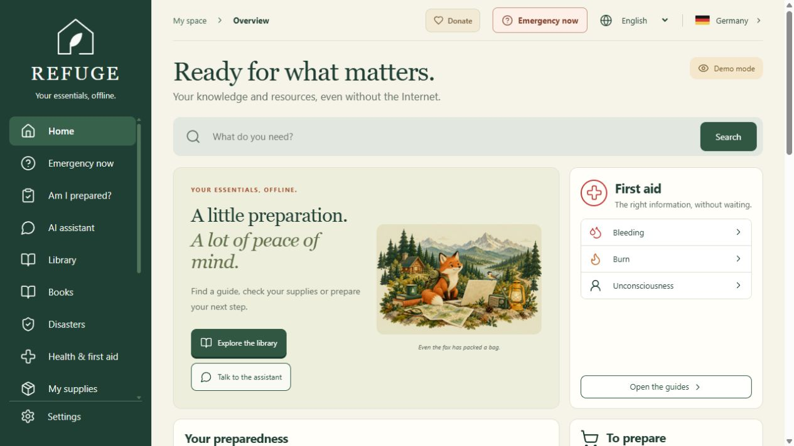
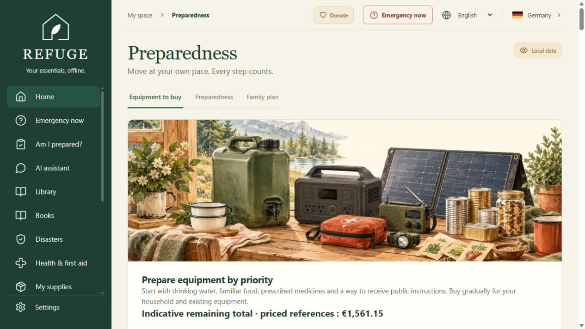
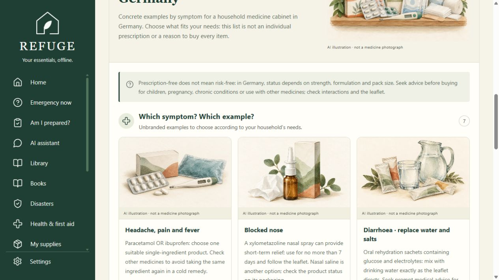
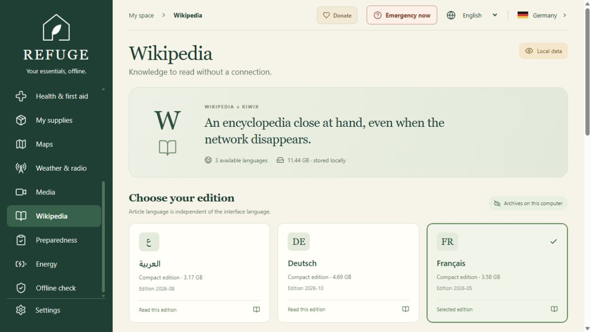

# REFUGE

**An offline preparedness companion for a small computer you control.**

REFUGE brings household planning, practical guidance, local documents, maps, Wikipedia and an optional local AI assistant into one multilingual interface. Prepare the computer and its resources while a connection is available, then keep useful information close when the internet is unavailable.

The project is intended to be **100% free to use**: no subscription, paid feature unlock or mandatory donation. Hardware, electricity, storage and internet preparation have their own costs. The source licensing decision is still pending; see [licensing and attribution](#licensing-and-attribution).

[Getting started](#getting-started) · [Offline preparation](#prepare-an-offline-installation) · [Hardware](#hardware-and-platform-status) · [Privacy](#your-data-stays-under-your-control) · [Release checklist](docs/public-release.md)



## Why REFUGE exists

Power cuts, floods, storms, displacement and the disruption caused by war can interrupt the services people usually rely on. Preparing calmly, before a disruption, gives a household more options: stored water, a plan for medication, a meeting point, a charged light and information that does not depend on a working mobile network.

Public authorities also encourage personal preparedness. Germany's [Federal Office of Civil Protection and Disaster Assistance (BBK)](https://www.bbk.bund.de/DE/Warnung-Vorsorge/Vorsorge/vorsorge_node.html) provides guidance on planning for emergencies. REFUGE follows the practical idea of initial household self-reliance while staying connected to official advice and community help. It has no government endorsement.

The aim is approachable: repurpose a small computer, prepare its contents in advance and make it useful for the whole household. A used mini-PC costing roughly **€50–€200 is a target hardware budget**, not a verified current offer or the price of a complete emergency kit. A screen, storage, battery, radio equipment and other supplies can cost extra.

REFUGE cannot guarantee safety or save a life by itself. It supports preparation; emergency services, current official instructions, practical first-aid training and tested physical supplies remain essential.

## What you can do

| Area                      | Available functions                                                                                       | Preparation or limitation                                                                |
| ------------------------- | --------------------------------------------------------------------------------------------------------- | ---------------------------------------------------------------------------------------- |
| Immediate help            | Emergency page, short first-aid guidance and printable instructions without asking the AI                 | Guidance and translations require human judgment; emergency calls need a working network |
| Household readiness       | Set household size and duration; check water, food, medication, energy, documents and evacuation supplies | Initial stock is demonstration data; confirmations are manual                            |
| Inventory and rotation    | Edit quantities and locations, record dates and consumption, plan purchases and no-cook meals             | Food item counts do not establish nutritional autonomy                                   |
| Equipment                 | Browse categories, selection criteria, buying links and a solar-kit energy estimate                       | Shops need internet; dated prices are examples, not live quotations                      |
| Practical library         | Read preparedness guides, hazard pages and downloaded PDF references                                      | Sources and review dates matter; translations are unofficial                             |
| Local AI                  | Ask questions with passages from local guides and PDFs; retain conversations locally                      | Requires a prepared model and engine; responses can be wrong                             |
| Wikipedia                 | Browse installed compact ZIM archives inside REFUGE                                                       | Reader and archives must be prepared; archive languages differ from interface languages  |
| Maps and personal places  | View the prepared Saxony map, save places and route notes, print or export GeoJSON                        | No route calculation; USB GPS needs compatible hardware and a satellite fix              |
| Weather and radio         | Read dated saved forecasts and radio preparation information                                              | Refresh needs internet; receiving radio needs a receiver, antenna and working setup      |
| Videos, books and media   | Read or play installed resources and manage supported local media                                         | A catalog entry does not mean the file is installed; language and rights vary            |
| Energy                    | Estimate loads and battery duration; enable economy mode to stop AI work                                  | Estimates depend on entered values; no guaranteed battery runtime or solar production    |
| Verification and recovery | Check resource presence and optional hashes; export/import data and create verified backups               | Full backups include private data and secrets; test restoration                          |

### Eight interface languages

**English · Français · Deutsch · العربية · Русский · 简体中文 · Español · Português**

Arabic uses a right-to-left layout. Documentary content has a separate language policy: French, German, English and Arabic are supported; **Russian, Simplified Chinese, Spanish and Portuguese fall back to English for documents that have not been translated**. PDFs, videos, books and Wikipedia retain the languages of the files actually installed. Selecting an interface language does not translate an entire archive.

### A look inside

[Watch the short, silent overview](docs/media/refuge-overview-en.mp4). This is a sequence of real screenshots, not a performance demonstration or a recording of a live emergency.



The equipment view connects practical choices with preparation, including power requirements for the computer and its screen.

The preparation catalog includes a 20 L drinking-water container, outdoor camping stove, water filter, FFP2 masks, garden seeds, balcony solar planning and optional Starlink connectivity. A separate household-pharmacy tab provides a general German shopping discussion list, with official sources and no personal dosing.

The preset power station is now an EcoFlow DELTA 3 Classic **1,024 Wh** model; its energy estimate uses the actual catalog capacity. Precise hardware offers include provider, date, scope and stock status. Food and hygiene remain household baskets without a fabricated complete-kit price. Alternative eBay searches are explicitly distinguished from verified offers.

The source includes 23 new generated editorial illustrations for equipment, pharmacy headings and symptom cards. They are clearly marked as illustrations, not exact product or medicine photographs. [Generation prompts and asset paths](docs/generated-illustrations.json) are recorded.

Product photos from the listed retailers/manufacturer can be prepared for local use with **node scripts/fetch-equipment-images.mjs** before **npm run build**. Rendering saved images requires no shop connection. The photo cache is excluded from Git; a fresh clone uses the available illustrations or icons until it is prepared. Product owners retain their image rights. Prices are dated observations; calculated VAT is labeled separately.



The pharmacy separates seven symptom/medicine example cards from first-aid supplies. German OTC status depends on product strength, formulation and pack size; use the cited sources and pharmacist advice. No individualized diagnosis or dose is generated.



The integrated reader uses local Wikipedia archives. Compact editions can omit images and shorten articles; title-prefix search in the embedded reader is not full-text encyclopedia search.

## Hardware and platform status

REFUGE is a local React application served by Node.js to a browser at **http://127.0.0.1:8099**.

| Component              | Starting point                                                                                                                                  |
| ---------------------- | ----------------------------------------------------------------------------------------------------------------------------------------------- |
| Node.js                | **22.12+ or 24**, with npm, for installation and building; Node.js 24 is the documented Windows launcher setup                                  |
| Computer               | A small x86-64 PC is the intended deployment target; an existing Windows computer can also run the app                                          |
| Memory for optional AI | **8–16 GB RAM is a target**, depending on model, context, operating system and other applications                                               |
| Graphics               | The documented local AI configuration runs on CPU; a dedicated GPU is not required for that configuration                                       |
| Storage                | Allow room for dependencies, selected PDFs/media/maps, ZIM archives, model and backups; a full prepared installation requires tens of gigabytes |
| Power                  | Computer and screen need electricity; battery capacity and real consumption must be measured                                                    |

The project has been developed and exercised on Windows. **Ubuntu 22.04 deployment on the intended mini-PC has not yet been validated.** Linux scripts and runtime preparation exist, but copying a folder is not a successful hardware test. Model response time and memory consumption must be measured on the actual computer; CPU AI can take a substantial time to answer.

See the [offline installation guide](docs/installation-offline.md) and [reliability notes](docs/fiabilite-preparation.md), currently in French, for the prepared configuration and remaining hardware checks.

## Getting started

### Build from the source repository

Use an internet connection for dependency installation and the explicit content download:

```sh
npm ci
npm run build
node scripts/fetch-content.mjs
node scripts/index-documents.mjs
npm start
```

Open **http://127.0.0.1:8099**. For frontend development, use `npm run dev`; this is separate from production startup above.

**A Git clone is the application code and tracked catalogs, not a complete offline appliance.** Models, runtimes, downloaded PDFs, maps, videos, books and Wikipedia archives are excluded from Git. Missing optional resources remain unavailable until explicitly prepared. Downloading PDFs above does not prepare Wikipedia or the AI engine.

The built application, local server and selected resource files must remain on the computer. Once prepared, the core interface and installed content do not need a CDN, remote font or cloud account. The browser must allow local storage to retain changes.

### Start an already prepared folder

Windows, with Node.js 24 installed:

```powershell
powershell -NoProfile -ExecutionPolicy Bypass -File .\DEMARRER-WINDOWS.ps1
```

Ubuntu x86-64, after transferring the complete prepared folder and correct Linux runtimes:

```sh
bash DEMARRER-UBUNTU.sh
```

These launchers expect the prepared portable engine and model layout. They do not download a missing model at startup. The Ubuntu launcher and hardware still need validation on the target computer.

## Prepare an offline installation

Choose resources while online. Check their language, date, storage requirements and permitted use. Catalogs under `content/` describe expected files and, where available, sizes and hashes; the installed files determine what works offline.

For cataloged videos, Wikipedia archives and radio packages, the explicit downloader is:

```sh
node scripts/fetch-offline-assets.mjs --videos --wiki --radio
```

Pass only the flags you need. These can be large downloads. Wikipedia also needs its prepared Kiwix reader; maps, book/media preparation and platform runtimes have additional steps. Follow the [complete installation and transfer guide](docs/installation-offline.md). This command does not install every feature. `bash scripts/prepare-ubuntu.sh` prepares dependencies, the frontend and PDFs on Ubuntu; it does not prepare the entire AI/media collection.

Before disconnecting, run the application's resource checks, open representative files and verify important hashes. Then disconnect the network, restart the computer and test your workflow: a guide, PDF, video, map, Wikipedia article, data export and, if installed, an AI response. Test battery operation, GPS and radio with real hardware.

Keep a second copy and rehearse a restoration. An old archive can omit newer resources. See [backup and restore](docs/backup-restore.md) and [transfer/distribution notes](docs/partage-refuge.md), currently in French.

## Optional local AI

The assistant integrates the Local Studio assistant interface with a local REFUGE backend. Conversations and tasks are stored in local SQLite. Relevant passages from prepared guides, hazard information and indexed PDFs can be added to a question. This is retrieval and context, not model training. **Wikipedia is browsed separately and is not indexed by the assistant.**

The documented Ollama configuration uses `qwen3:4b-instruct-2507-q4_K_M`. Copy `.env.example` to `.env` and review its settings. Prepare Ollama and the model while online, using its local-only service on port `11479`, the project's `models` folder and `OLLAMA_NO_CLOUD=1`. With that service running, explicitly fetch the model:

```sh
node scripts/fetch-local-model.mjs
```

The [offline guide](docs/installation-offline.md) explains engine settings and the portable runtime layout. Model size, RAM use and CPU speed vary. A mock-engine test does not demonstrate a model's quality or performance on your hardware.

An existing Local Studio installation on the **same computer** can be configured instead. A separate remote Studio mode is optional, needs a network and credentials, and sends the chosen question and reference passages to that server. Local mode does not automatically fall back to the remote service. Never put an API key in frontend code or Git. See the [integration and code provenance notes](docs/local-studio-integration.md).

The assistant can produce incorrect instructions and citations. Check source documents, especially for first aid, medication, food safety and hazardous situations. It is not a medical professional or a safe way to identify edible plants or mushrooms.

## Your data stays under your control

Household preferences, inventory, places and other personal settings are stored in the browser. AI history is stored separately by the local server. Browser data is not encrypted or automatically synchronized between devices; use demonstration data when showing the application publicly.

Export personal data regularly. A JSON export covers supported browser state, not the AI database, model or full content library. A full offline backup is different: it can include `.env`, SQLite history and personal exports. Protect it and never upload it as a public release.

The repository ignores local resource folders, `data/`, `models/`, `runtime/`, `private/`, build output and real `.env` files. Ignore rules do not remove already committed files or clean repository history. Public release needs a separate review of tracked files, past commits, screenshots and archives.

The main server binds to loopback. Access from another device requires deliberate network and authentication configuration. The local app is not a public hosting setup.

## Development and verification

```sh
npm test
npm run build
npx playwright test
```

Browser checks need local Chrome and prepared resources for the features exercised. Playwright starts the local server or reuses an existing one. Some browser tests block external requests to exercise offline behavior. AI contract tests use a simulated engine; real inference, complete content availability and target-device operation require separate checks.

| Path             | Purpose                                                    |
| ---------------- | ---------------------------------------------------------- |
| `src/`           | React interface, translations, planning and local state    |
| `server/`        | Local HTTP/API services and AI integration                 |
| `content/`       | Source catalogs and prepared resource folders              |
| `scripts/`       | Downloads, preparation, indexing, backup and distribution  |
| `deploy/`        | Optional Compose services and Ubuntu service configuration |
| `tests/`, `e2e/` | Node tests and browser scenarios                           |
| `docs/`          | Installation, sources, limitations and release preparation |

Optional Docker Compose definitions cover Ollama, Kiwix and Grocy; these are additional deployment choices and have not been validated as the target mini-PC installation. Grocy's stock is separate from REFUGE's inventory.

## Licensing and attribution

**There is currently no root software license in this repository.** A public repository is not automatically open source and does not by itself grant broad permission to reuse, modify or redistribute the code. The owner's intention to offer REFUGE free of charge is separate from choosing a software license. The licensing decision and provenance of integrated code must be resolved before presenting a release as open source.

Third-party components, model weights, map data, encyclopedic content, books, PDFs and videos retain their own terms. Source URLs and provenance are recorded in catalogs and documentation; these records still require a distribution review. Free access to a PDF or video is not permission to bundle it in a public archive. Modified Kiwix sources, licenses and required notices must accompany any distribution as required by their terms.

See [Local Studio provenance](docs/local-studio-integration.md), [map and radio sources](docs/radio-gps-meteo-cartes.md), [book sources](docs/books.md), [video sources](docs/videos-survie-sources.md) and the [public release checklist](docs/public-release.md).

## Support the project

The donation screen has an explicit **continue for free** option. A donation does not unlock a feature, and payment is never required to use REFUGE. Public donation addresses and local QR codes are intentional; private keys, wallet recovery phrases and private access credentials must never be included in the project.

Useful contributions also include testing a restored installation without internet, reporting a reproducible bug, reviewing a translation and identifying a better primary source. When reporting a problem, describe the platform, language, installed resources and expected behavior. Remove personal data from logs and screenshots.

The [previous French README](docs/README.fr.md) is retained as a historical reference. Several detailed operational documents remain in French; this English README describes the project scope and separates prepared resources from repository contents.
