# REFUGE — English screenshot tour

[Project overview](../README.md) · [Installation](installation.md) · [Short silent overview](media/refuge-overview-en.mp4)

These are real screenshots of the local application, captured on 1 November 2026. The interface is English. Household values are marked demonstration data. The installation shown has prepared resources; downloading the repository alone does not include those archives, books or media. Content retains its own language.

## Home

Search useful information, open first-aid shortcuts and see the demonstration household's preparation at a glance.

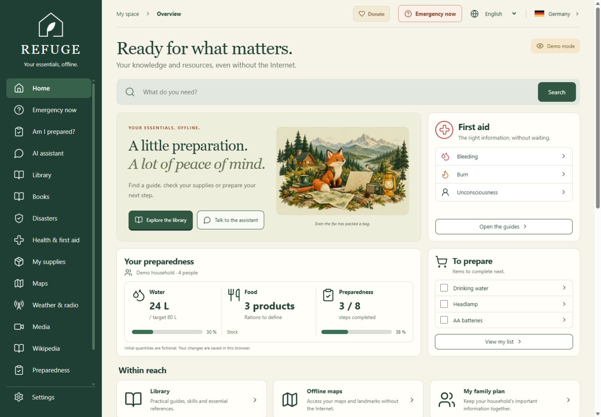

## Emergency now

Open immediate actions without waiting for an AI response. Emergency contact links remain ahead of the illustrated guidance cards.

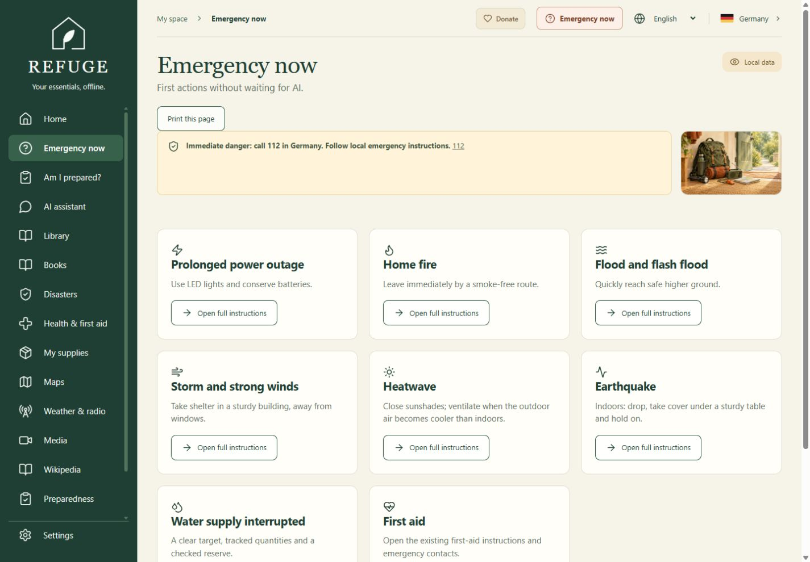

## Am I prepared?

Review household needs and practical checks. Completion is based on manual confirmation, not a safety certification.

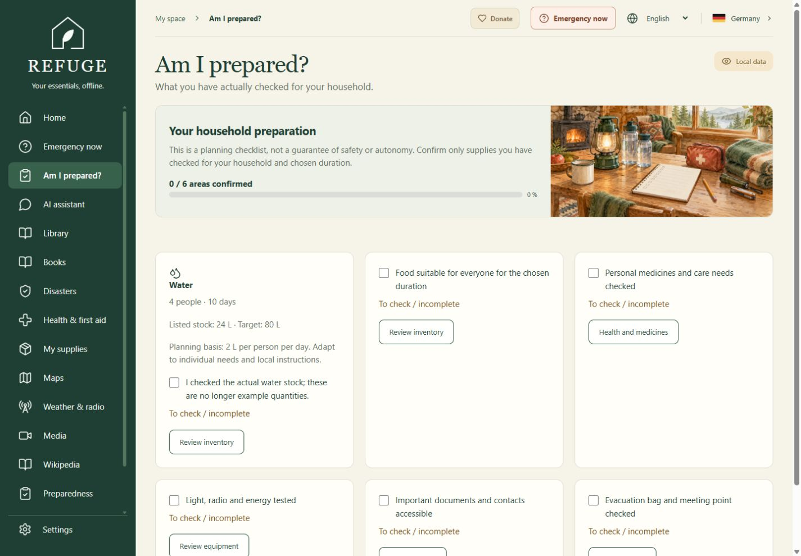

## My supplies

Manage quantities, locations, dates, consumption, shopping and no-cook meal planning. Water coverage is labeled separately from food autonomy.

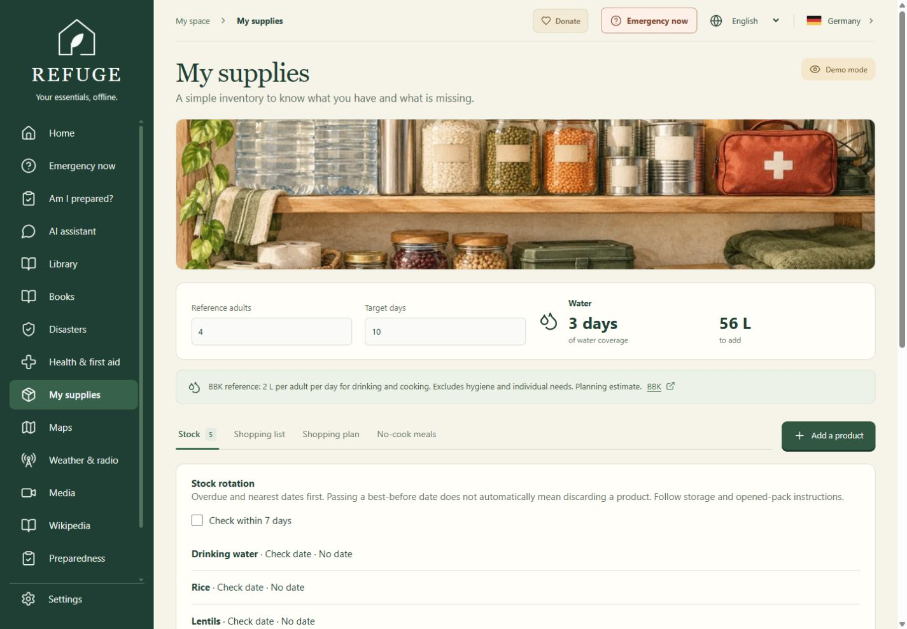

## Practical library

Browse illustrated guidance and saved references. Check each document's source, date and actual language.

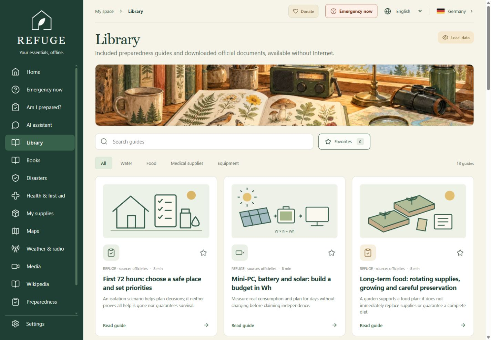

## Books

Filter by language and genre, search authors and titles, then read installed files locally. Cover artwork is an editorial illustration, not a publisher's original cover. Counts show this prepared computer only.

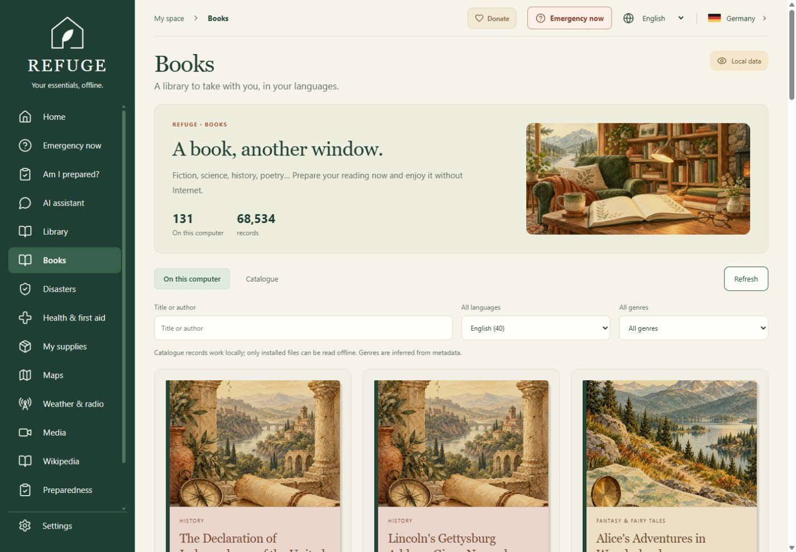

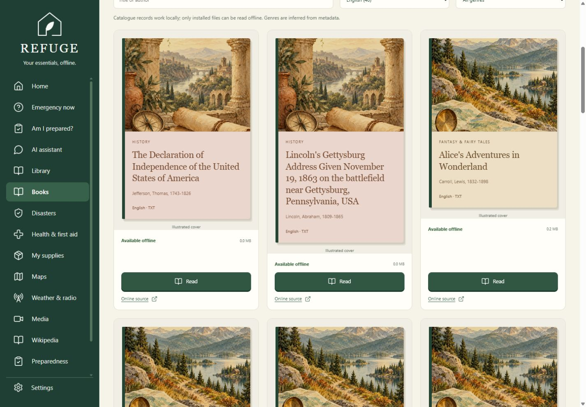

## Disasters

Explore scenario-specific guidance, including heat, cold, flooding, tsunami and power interruptions. Follow local official instructions in a real event.

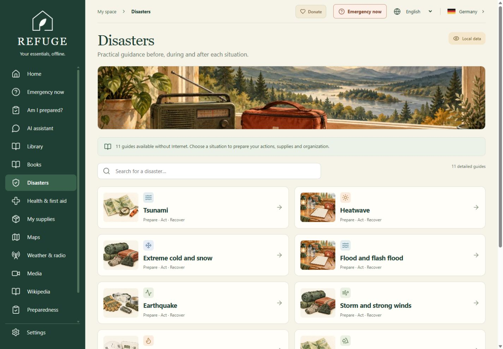

## Health and first aid

Keep emergency contact information, short first-aid guidance and downloaded references close. Medication examples have sources and precautions; they do not prescribe an individual treatment.

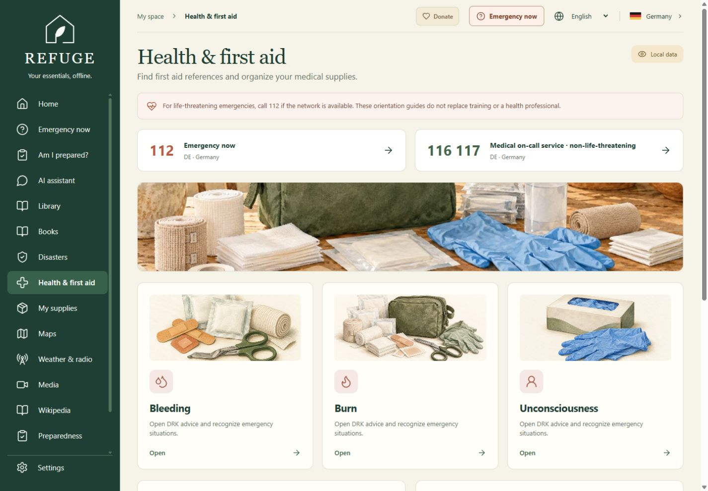

## Equipment and household pharmacy

Compare preparation categories, criteria, dated offer examples and estimated power needs. Retailer links require internet; saved images and explanatory text remain local.

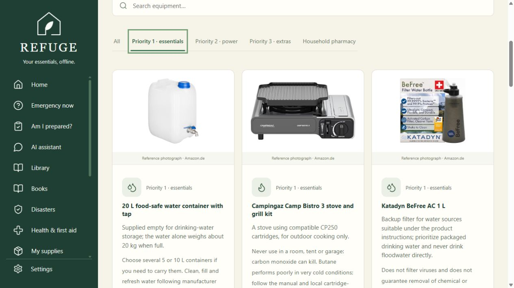

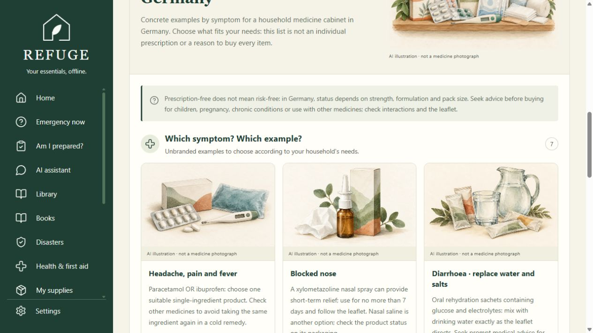

## Wikipedia

Choose among actually installed archives. The interface language and an encyclopedia's language are separate. Compact archives may omit media or shorten articles.

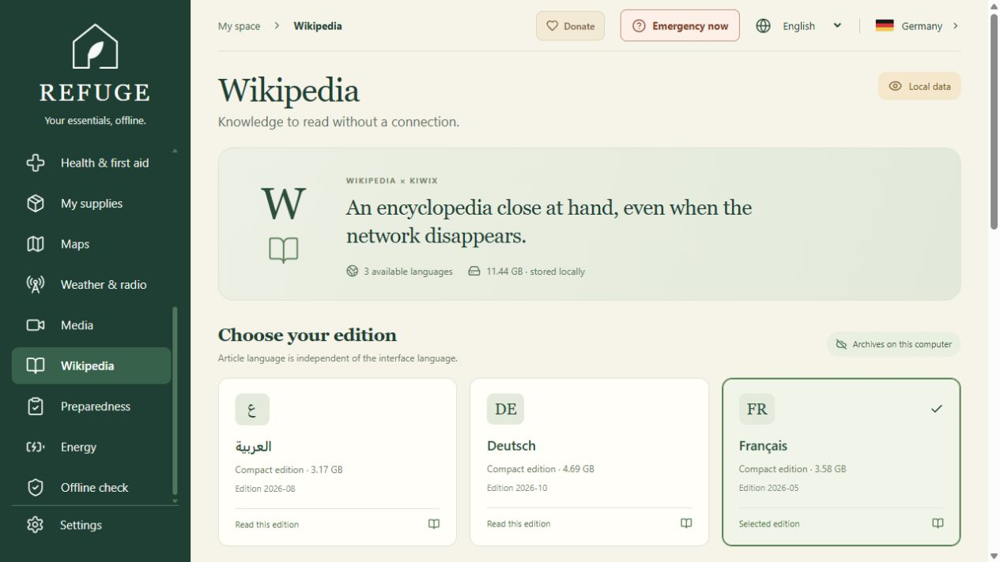

## Images included with installation

The generated page and genre illustrations shown here are bundled in `public/illustrations/` and copied into the production build. See [installation and image transfer](installation.md#included-illustrations-and-optional-product-photos), [page/cover prompts](generated-page-illustrations.json) and [equipment/pharmacy prompts](generated-illustrations.json).
